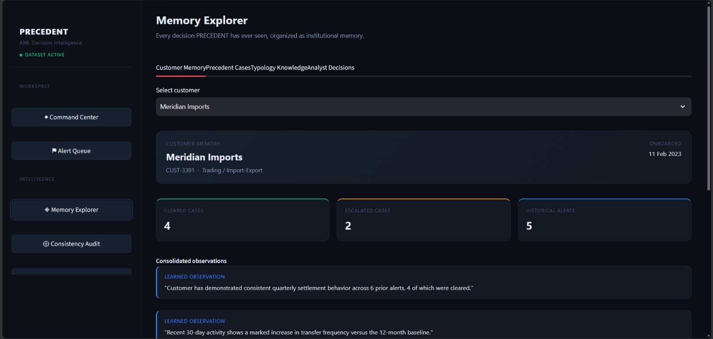
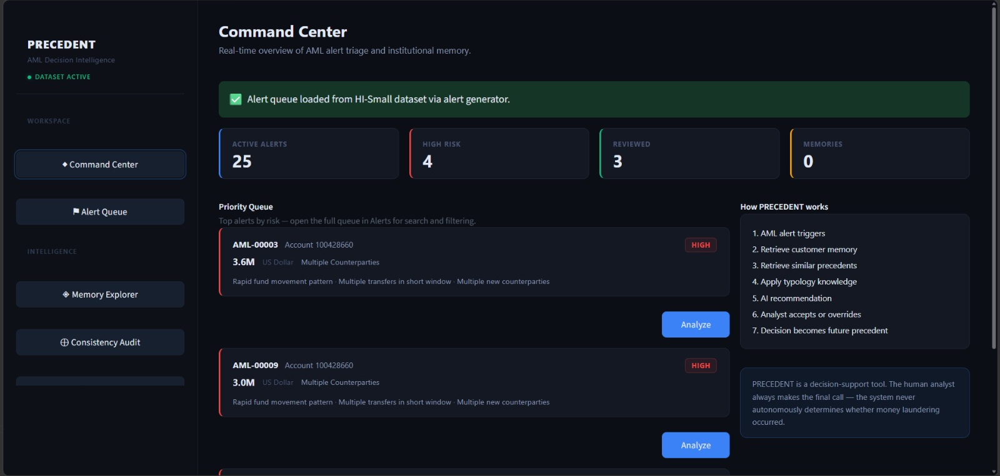
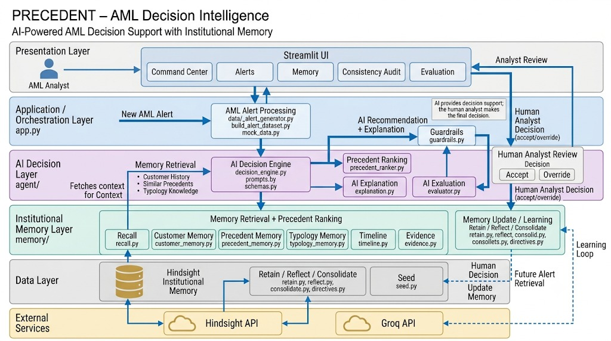
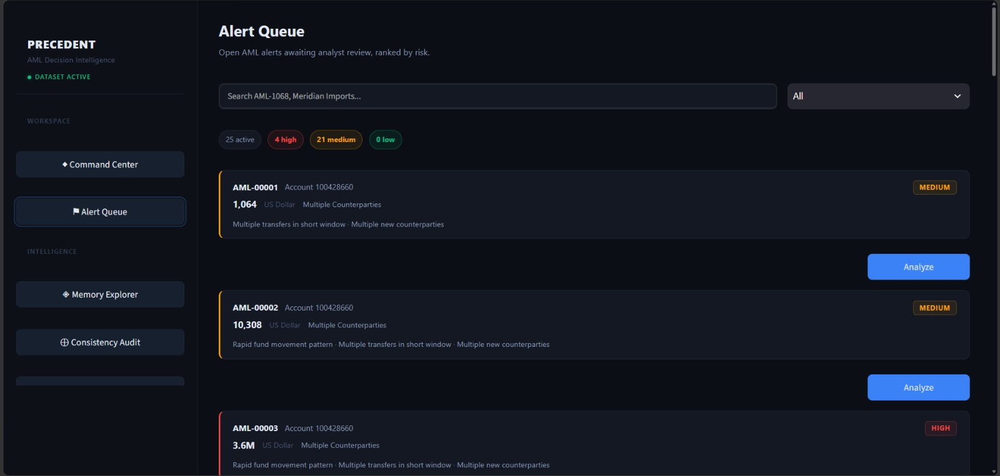
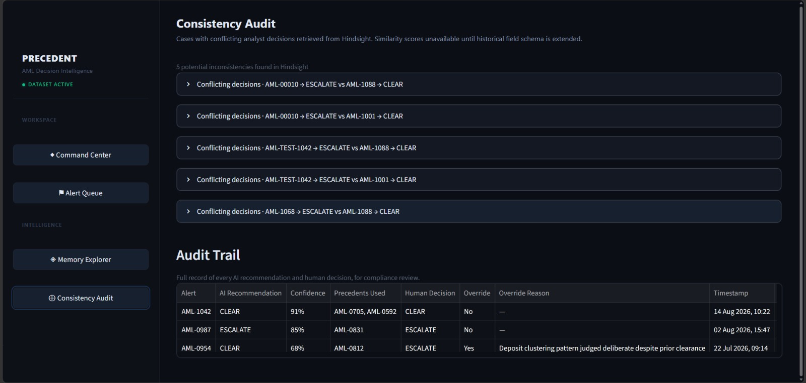

# I Turned Analyst Overrides Into Hindsight Memory

## The Problem

The most useful thing an AML system can remember may be the moment its analyst disagreed with it. That disagreement carries a final decision and a reason—context a future alert can retrieve instead of starting from a blank slate.

PRECEDENT is a decision-support application built around that gap. Its memory layer uses [Hindsight GitHub](https://github.com/vectorize-io/hindsight) to retain alert and decision records, recall tagged history, and reflect over accumulated memories. The idea is to make past decisions available as context for future review. That context can help an analyst reason consistently, but it does not turn the system into an autonomous AML adjudicator.

The repository makes this human boundary explicit. The command center describes the analyst as the final decision-maker; the decision engine returns a structured recommendation and review flag; and the Streamlit alert view exposes accept and override actions. The important engineering question is what happens after the analyst disagrees with the recommendation. If that decision and its rationale disappear after the current session, the system cannot reuse the judgment later.

## Why Historical Context Matters

Consider Meridian Imports, a demo customer in `data/mock_data.py`. The open alert AML-1068 concerns ₹840,000 and Rapid Movement. Its signals include multiple transfers in a six-hour window, new counterparties, and a sudden change against a 12-month baseline. The mock customer history records quarterly import settlements, prior cleared and escalated alerts, and a recent increase in transfer frequency.

Those details create a real decision problem: earlier legitimate settlements are relevant, but they do not erase the significance of new counterparties and changed behavior. A useful decision-support system should surface the old decisions and their reasons so an analyst can compare them with the new facts. The example is explicitly demonstration data; it does not establish that a live bank customer was reviewed or that any measured outcome resulted.

The repository separates three memory questions. Customer memory asks, “What has happened with this entity?” `memory/customer_memory.py` recalls records tagged with a customer ID and sorts them into alerts, decisions, observations, unresolved issues, and recent events. Precedent memory asks, “Which past decisions look relevant to this alert?” `memory/precedent_memory.py` uses the current customer, typology, and transaction pattern to form a recall query. Typology memory asks, “What patterns and exceptions have accumulated across cases of this type?” `memory/typology_memory.py` retrieves a Hindsight mental model when available and falls back to reflection.

Customer history is longitudinal context about one subject; a precedent is a candidate comparison; typology knowledge is a broader synthesis. Mixing these scopes can make recommendations harder to explain or overstate comparability.



## How PRECEDENT Works

The intended product flow is easy to describe: an alert arrives; the system retrieves historical context; a decision engine analyzes the alert and precedents; guardrails constrain the recommendation; the analyst accepts or overrides it; and the final decision is retained so a future alert can use it.





*Architecture diagram.*

`integration/precedent_service.py` bridges Hindsight and `agent/decision_engine.py`: it retrieves and filters authoritative precedents, removes the current alert from its own history, normalizes records, and calls the engine. It returns UI-ready cards and falls back to human review if analysis fails.

`memory/recall.py` passes the bank, query, tags, match mode, temporal window, and trace option to Hindsight and returns its results and response object. `memory/hindsight_client.py` lazily creates the client from environment settings in `memory/config.py`; `memory/health.py` checks the key and bank reachability.

The service treats recall results as candidates: only records with a known alert ID, metadata, and final decision reach the model as precedents.

## Where Hindsight Fits

Hindsight is the persistent memory service, not the decision engine. The boundary is visible in the adapter:

```python
from memory.precedent_memory import get_precedents
recall_result = get_precedents(alert)
```

This excerpt from `integration/precedent_service.py` delegates retrieval to the memory subsystem. That subsystem builds a query from alert attributes, requests recall from the configured Hindsight bank, and converts returned results into precedent dictionaries. Keeping that work behind a memory module gives the rest of the application a stable shape even when the storage API returns its own response objects.

The adapter then takes care not to manufacture comparison data. In its normalization path it discards the typology copied from the current alert and only supplies comparison fields present in the historical record. That is important because comparing an alert to itself—or borrowing the current alert's values for a past case—would produce misleading similarity. The code comments call out a current limitation: `precedent_memory.py` does not extract some potentially useful historical fields such as transaction pattern and amount into its returned precedent dictionary. As a result, the UI may show “Relevant precedent” where it cannot support an honest percentage.

`agent/precedent_ranker.py` computes a simple weighted score from matching customer, typology, transaction pattern, and amount. The decision engine asks for the top three and keeps scores at or above 0.5 before building the AML prompt. The score is a hand-coded similarity function, not a learned risk probability. That distinction is essential when displaying a ranking to analysts.

## Retain, Recall, Reflect and Consolidate

The memory lifecycle has four useful operations. Retain writes a decision record. Recall fetches candidate records for a specific question. Reflect asks Hindsight to synthesize accumulated context. Consolidation-related code retrieves observations and reports bank-level memory statistics; typology mental models can also be created and refreshed. In this repository, “consolidate” is not a background pipeline that automatically runs after every decision.

The central write path records both the recommendation and the analyst’s final decision:

```python
override = (agent_recommendation != final_decision)
...
if override:
    tags.append("override")
```

This is from `memory/retain.py`. The function constructs a readable decision record, tags it with customer, alert, decision, and typology labels, and stores metadata including recommendation, final decision, override status, analyst reason, and timestamp. The `override` tag makes disagreement discoverable during later retrieval. The write is performed through Hindsight’s `retain` call with an “Analyst Decision Record” context.


In the UI flow, `record_analyst_decision()` in `integration/precedent_service.py` combines the analyst’s reason and optional note, passes the final decision to `retain_analyst_decision()`, and includes precedent IDs and confidence as extra metadata when available. A successful override is therefore available to future recall as a decision with an explicit human outcome and rationale. This is the actual learning loop: the application does not update model weights; it stores a human-reviewed memory that can become future context.

Recall supports different query shapes. Customer history uses an all-match customer tag; precedent recall asks about customer, typology, and transaction pattern using any-match tags. Filtering and ranking follow, because recall results are candidates rather than automatically trusted answers.

Reflect serves a different purpose. `memory/reflect.py` asks Hindsight to summarize accumulated customer or typology history, optionally constrained by tags and with facts included. `memory/customer_memory.py` uses a customer reflection to add unresolved issues to the history result. `memory/typology_memory.py` first tries the stored mental model, then falls back to a reflect query if no summary is available.

Hindsight directives in `memory/directives.py` reinforce important epistemic constraints: do not invent history, distinguish analyst decisions from facts, state when evidence is insufficient, and do not conceal uncertainty. The code lists and creates named directives in the configured bank. Those constraints are especially relevant when a reflection compresses many records into prose.

## From Alert to Analyst Decision

The decision engine in `agent/decision_engine.py` applies deterministic guardrails before calling the language model. A PEP or watchlist match forces escalation and human review. Otherwise it ranks the supplied precedents, builds a prompt, requests JSON, validates the decision and risk level, clamps confidence to the 0–1 range, and returns a `DecisionResult` with cited precedent IDs and key factors. `agent/explanation.py` formats that structured result, while the prompt and schema establish the expected response shape.

The Streamlit interface is the human-facing layer. In `views/alerts.py`, the analyst sees a recommendation, reasoning, a memory influence panel, and accept or override controls. When an override is submitted, the view calls the integration service and stores the returned state in the Streamlit session. `views/memory.py` presents memory-oriented context, while `views/audit.py` shows audit and consistency information.



Evidence remains important in this chain. `memory/evidence.py` extracts facts from Reflect responses or source text, IDs, and metadata from Recall results. The wrapper only extracts evidence when given the original response object. That gives callers provenance fields to display or inspect, but the current decision result does not automatically attach this evidence bundle to every recommendation. A memory result and a model-generated explanation should not be conflated.

## When Historical Decisions Matter

The override learning test gives a concrete end-to-end example. It retains alert AML-TEST-1042 for a synthetic test customer and records that the agent recommended CLEAR while the human analyst chose ESCALATE because of recent behavioral change. It then asks for precedents for a similar next alert and asserts that the prior alert is retrievable with the ESCALATE decision, override flag, reason, and timestamp intact.

That test demonstrates the intended contract: a future alert can recover not merely that a case existed, but what the analyst decided and why. A precedent can therefore carry disagreement forward as useful context rather than silently treating the model’s original recommendation as the outcome. The test depends on a configured Hindsight service and includes a wait for indexing; it is an integration test of that configured path, not evidence of production impact.

Consistency auditing is present, but the source of its data needs to be stated accurately. `views/audit.py` renders cases with similar-looking alerts and conflicting decisions, and labels them as demo data. The underlying `get_inconsistencies()` data comes from `data/mock_data.py`; it is not a live audit query over the Hindsight bank. The audit view is a useful interaction design for surfacing disagreements, but it does not prove that PRECEDENT currently detects inconsistency across retained memories.



## What I Learned

The design turns an analyst decision into a durable, queryable artifact. The final decision, whether it differed from the recommendation, and the analyst’s explanation all matter to future review. Hindsight stores and retrieves these facts; the application decides what is authoritative.

The human-in-the-loop boundary should stay visible in code and UI. The model proposes, guardrails can force review, and the analyst records the disposition. A retained decision is evidence of what happened in a review, not proof that its conclusion was objectively correct. Four lessons follow:

- Store the analyst’s final decision and rationale, not just the model recommendation.
- Treat recall results as candidates; validate metadata before ranking or prompting.
- Keep customer history, comparable precedents, and typology synthesis as separate scopes.
- Withhold similarity percentages when the retained record lacks comparison fields.

## Limitations

The repository contains demo and mock material alongside the Hindsight integration. `data/mock_data.py` explicitly labels its customer, precedent, audit, and evaluation values as mock/demo data, and `views/audit.py` repeats that warning for its consistency audit. The evaluation page’s displayed comparisons must therefore be read as demonstration values, not measured production performance.

There is also a gap between the broad product flow and what `analyze_alert()` currently wires into the model. The integration pipeline supplies recalled precedents to the decision engine; customer history and typology summaries are implemented in memory modules and exposed in UI-oriented paths, but are not both explicitly assembled into the decision prompt in that function. Another practical lesson is that metadata quality governs what the ranker can compare. Until historical amount, typology, and transaction-pattern values survive the full retain-to-recall mapping, ranking can be based on sparse fields and the UI correctly withholds unsupported scores.

For more on the memory model behind this integration, see [Hindsight documentation](https://hindsight.vectorize.io/) and [Vectorize agent memory](https://vectorize.io/what-is-agent-memory).
